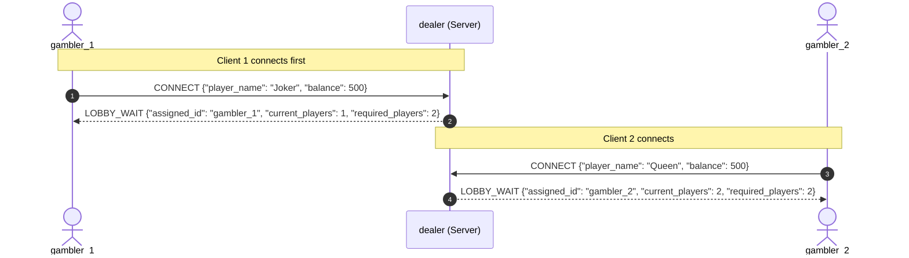
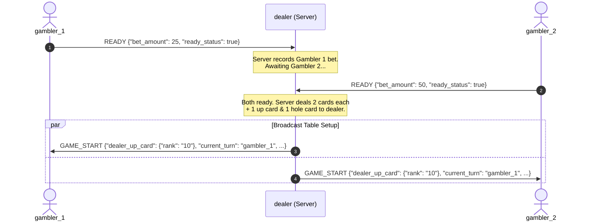
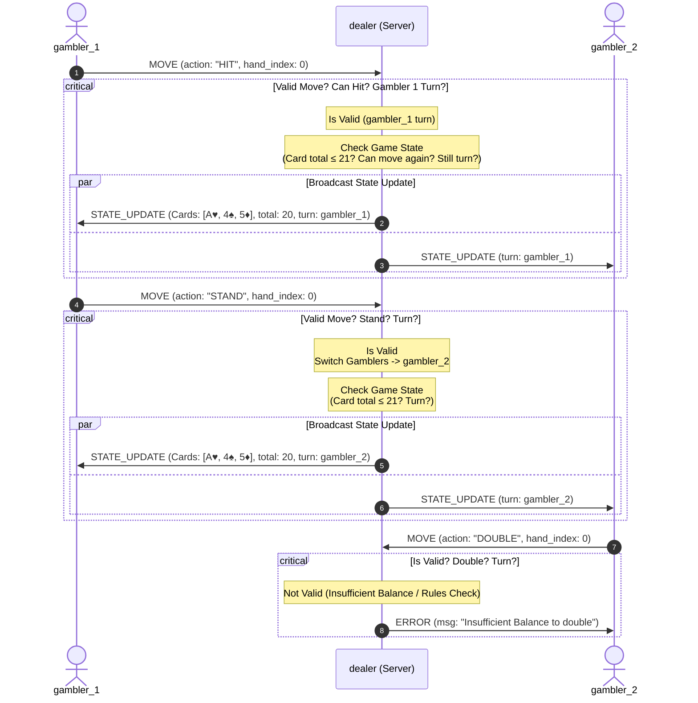
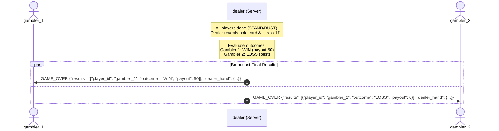
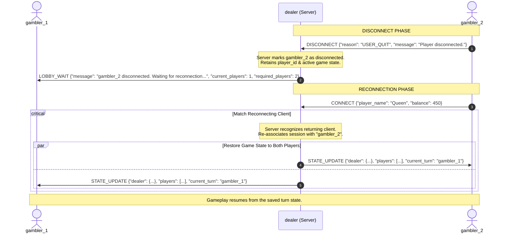

# State & Score Synchronization Across Clients (Sprint 2 Deliverable)
## CONNECT & LOBBY_WAIT Sequence

## READY & GAME_START Sequence

## MOVE & STATE_UPDATE Sequence

## GAME_OVER Sequence

## DISCONNECT & RECONNECT Sequence

